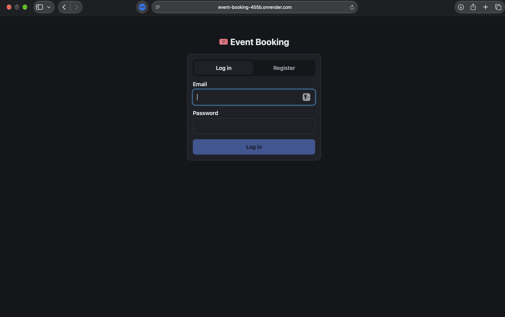
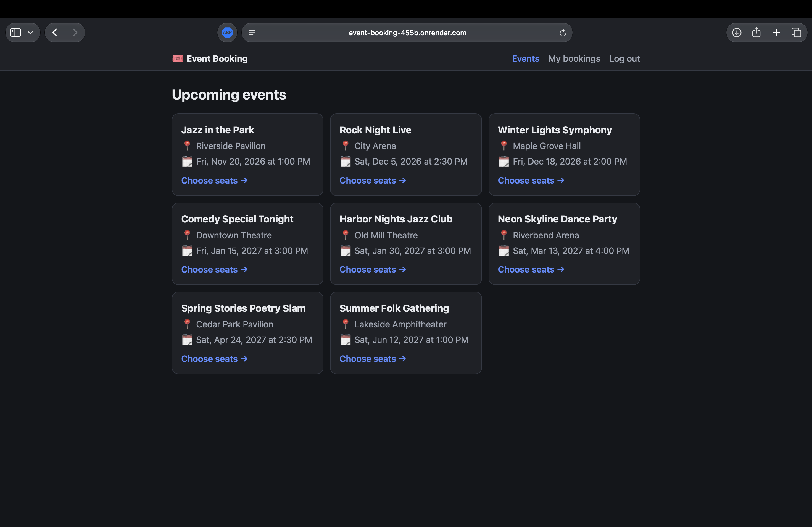
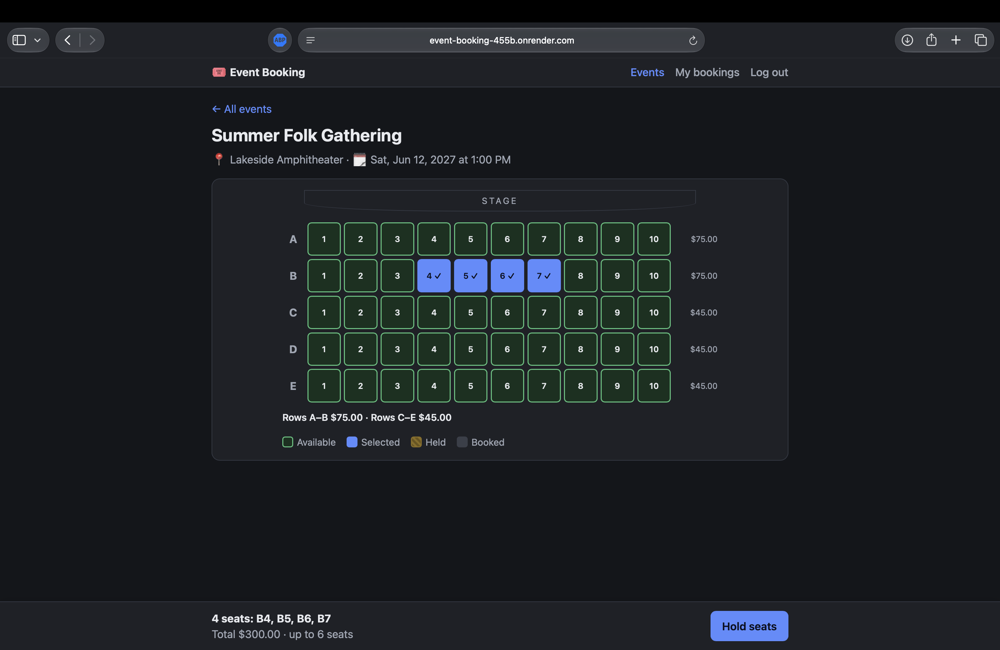
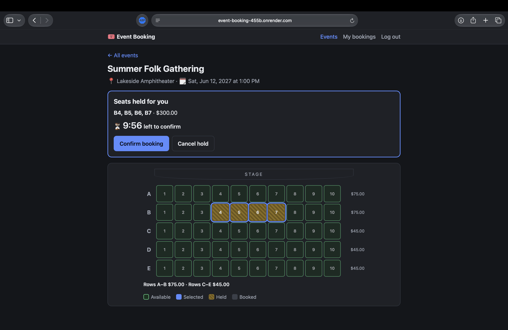
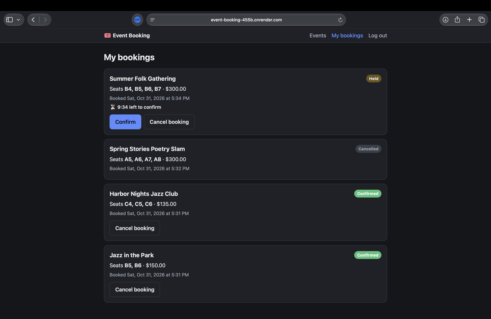
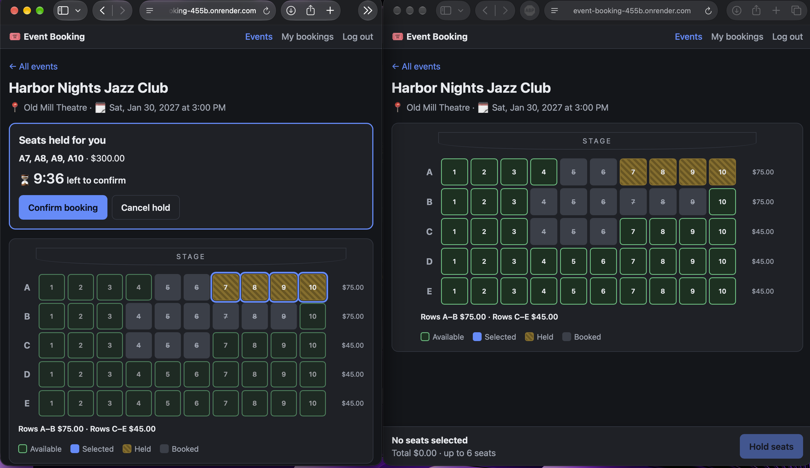
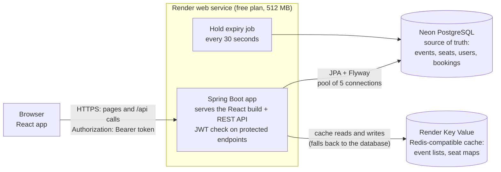

# 🎟️ Event Booking

[](https://github.com/HarshithMeda/event-booking/actions/workflows/ci.yml)

A full-stack event ticket booking app. Users browse events, pick seats on a seat map, hold them for 10 minutes and then confirm or cancel. The core problem it solves is **double booking**: when two people try to take the same seat at the same moment, exactly one of them gets it.

Built with Spring Boot 4 (Java 21), React, PostgreSQL and Redis, tested against real databases with Testcontainers, and deployed with Docker.

## Live demo

**https://event-booking-455b.onrender.com**

| | |
|---|---|
| Email | `user1@example.com` |
| Password | `TestPass2026` |

- This is a **shared test account with fake data**. Anyone can log in with it, so please don't enter anything real. You can also register your own account.
- **All events, venues and bookings are made-up sample data.** No real tickets are sold.
- The app runs on a **free hosting plan that goes to sleep after 15 minutes without visits**. The first page load after that can take **about a minute** while it starts up again.
- API documentation (Swagger UI): https://event-booking-455b.onrender.com/swagger-ui.html

## Screenshots

| Log in | Upcoming events |
|---|---|
|  |  |

| Choosing seats | Seats held, with countdown |
|---|---|
|  |  |

**My bookings:** held, confirmed and cancelled bookings, with seats and totals.



**Two users at once:** the user on the left holds A7–A10. The user on the right sees those seats turn to "held" on their next automatic refresh (every 10 seconds), so they can't be taken twice.



## Features

- **Accounts:** register and log in with email and password. Passwords are stored as BCrypt hashes, and login returns a signed JWT (JSON Web Token) that lasts 60 minutes.
- **Browse events:** upcoming events sorted by date, with paging on the API.
- **Seat map:** a grid of rows A–E and seats 1–10, colour-coded (and marked with ✓ or strike-through) as available, selected, held or booked. Front rows cost more.
- **Hold, then confirm:** pick 1 to 6 seats and see the total in dollars. The seats are held for 10 minutes with a countdown, then you confirm or cancel.
- **No double booking:** if a seat was just taken, you get a friendly message and the seat map refreshes. A hold is all or nothing.
- **Automatic expiry:** a background job releases holds that weren't confirmed in time.
- **My bookings:** your bookings with status and seats. Confirmed bookings can be cancelled, which puts the seats back on sale.
- **Session handling:** an expired or invalid token sends you back to the login screen.
- **Works on phones:** the seat map fits a phone screen with tappable seats.
- **Fast reads:** event lists and seat maps are cached in Redis. If Redis is down, the app keeps working from the database.

## Tech stack

| Area | Tools |
|---|---|
| Backend | Java 21, Spring Boot 4, Spring Web MVC, Spring Data JPA (Hibernate), Bean Validation |
| Security | Spring Security, OAuth2 Resource Server (JWT, HS256), BCrypt |
| Database | PostgreSQL, Flyway migrations (Hibernate only validates the schema) |
| Cache | Redis via Spring Cache and Lettuce |
| Frontend | React 19, TypeScript, Vite, oxlint |
| API docs | springdoc-openapi (Swagger UI) |
| Testing | JUnit 6, Mockito, MockMvc, Testcontainers (PostgreSQL 17 and Redis 7) |
| Delivery | Docker (multi-stage build), Docker Compose, GitHub Actions |
| Hosting | Render (web service and Key Value), Neon (PostgreSQL) |

## Architecture



- **One server for both:** the React app is built into the Spring Boot jar, so one server on one URL serves the screens and the API.
- **The database decides:** PostgreSQL is the only source of truth. Redis is used only for display data (event lists and seat maps) and is never consulted when booking.
- **Cache refresh after changes:** after a hold, confirm, cancel or expiry commits, that event's cached seat map is deleted, so the next read is fresh.

## How double booking is prevented

Each seat row has a `version` number, and the app uses **optimistic locking** on it. Holding seats happens in one database transaction:

1. Load the requested seats, sorted by ID, and check they are all `AVAILABLE`.
2. Mark them `HELD` and save. Hibernate runs `UPDATE seats ... WHERE id = ? AND version = ?`.
3. If another request changed a seat first, that `UPDATE` matches 0 rows. The whole transaction rolls back, nothing is held, and the API returns **409 Conflict**.

Updating seats in ID order prevents deadlocks between overlapping requests. Bookings also have a `version` column, so confirm, cancel and the expiry job can't overwrite each other.

This is tested with **20 threads holding the same seat at the same instant** against real PostgreSQL: exactly one wins every time, and only one booking ever contains the seat.

➡️ The full design, with key terms, a timeline of the race, optimistic vs pessimistic locking and interview questions, is in **[docs/booking-design.md](docs/booking-design.md)**.

## API

All responses are JSON. Errors use the standard `ProblemDetail` format (RFC 9457). Endpoints marked 🔒 need an `Authorization: Bearer <token>` header from `/api/auth/login`.

| Method | Path | Description |
|---|---|---|
| `POST` | `/api/auth/register` | Create an account: `{email, password}`. Password is 8–72 characters. Returns 201, or 409 if the email is taken. |
| `POST` | `/api/auth/login` | Log in. Returns `{accessToken, tokenType, expiresIn}`, or 401. |
| `GET` 🔒 | `/api/me` | The logged-in user |
| `GET` | `/api/events?page=0&size=20` | Events sorted by start time, paged (size 1–100) |
| `GET` | `/api/events/{id}` | One event, or 404 |
| `GET` | `/api/events/{id}/seats` | The event's seat map with prices and status |
| `POST` 🔒 | `/api/bookings` | Hold seats: `{eventId, seatIds}` (1–6 seats). Returns 201, or 409 if a seat is taken. |
| `POST` 🔒 | `/api/bookings/{id}/confirm` | Confirm your hold before it expires (409 if expired) |
| `POST` 🔒 | `/api/bookings/{id}/cancel` | Cancel a held or confirmed booking; the seats go back on sale |
| `GET` 🔒 | `/api/bookings` | Your bookings, newest first |
| `GET` | `/actuator/health/readiness` | Health check used by the hosting platform |

Another user's booking returns **404**, not 403, so nobody can find out which booking IDs exist. The full interactive docs are at `/swagger-ui.html`.

## Testing and CI

**69 automated tests** (33 unit, 36 integration):

- **Unit tests (JUnit and Mockito)** for the booking, auth and event services:
  - holds, confirm, cancel and expiry;
  - ownership checks and input validation;
  - duplicate email and wrong password;
  - what happens when a version check fails.
- **Integration tests (MockMvc and Testcontainers)** that start real **PostgreSQL 17** and **Redis 7** containers. Flyway runs every migration exactly as in production. They cover:
  - security: 401 without a token, and forged, edited, unsigned and expired tokens rejected;
  - register and login;
  - the booking API, including another user's booking returning 404;
  - the expiry job and the Redis cache;
  - the concurrency test above.
- Tests use their own dummy JWT secret and never read local secrets.

GitHub Actions runs three jobs on every push and pull request:

| Job | What it does |
|---|---|
| Tests | `./mvnw verify` on Java 21, with Testcontainers on the runner's Docker |
| Frontend | `npm ci`, `npm run lint`, `npm run build` |
| Docker image | Builds the production image (not pushed anywhere) |

Run the tests locally (Docker must be running):

```bash
./mvnw verify                                  # backend: unit + integration tests
cd frontend && npm ci && npm run lint && npm run build
```

## Run it locally with Docker Compose

You need Docker. This starts the app, PostgreSQL 17 and Redis:

```bash
git clone https://github.com/HarshithMeda/event-booking.git
cd event-booking
cp .env.example .env      # then edit .env and set DB_PASSWORD and JWT_SECRET
docker compose up --build
```

Then open **http://localhost:8080** and register an account. The database starts with the 8 sample events.

- **`.env`** is git-ignored and holds your local secrets. Generate random values with `openssl rand -hex 32`. `JWT_SECRET` must be at least 32 characters. [`.env.example`](.env.example) shows the format, with placeholders only.
- **Data survives `docker compose down`**, because it's stored in a named volume. `docker compose down -v` deletes it.
- Postgres and Redis aren't exposed to your machine, only to the app container.

**Frontend development with hot reload:** run the backend on port 8080 (for example with Docker Compose), then:

```bash
cd frontend
npm ci
npm run dev               # http://localhost:5173, /api calls are proxied to :8080
```

### Deployment settings

The app reads its settings from environment variables:

| Variable | Contains |
|---|---|
| `SPRING_DATASOURCE_URL` | `jdbc:postgresql://<host>/<database>?sslmode=require` |
| `SPRING_DATASOURCE_USERNAME` / `SPRING_DATASOURCE_PASSWORD` | Database login |
| `APP_JWT_SECRET` | Random string, at least 32 characters |
| `SPRING_DATA_REDIS_URL` | Redis URL, for example `redis://<host>:6379` |
| `PORT` | HTTP port (default 8080; Render sets it automatically) |

The Docker image sizes Java's memory for a small container: about 40% of the memory limit goes to the heap, and compiled code and class metadata are capped. On a 512 MB container, peak memory under load measured about 390 MB.

## Known limitations

This is a portfolio project, not a production ticketing system.

- **Shared demo account:** anyone can see and change `user1@example.com`'s bookings.
- **Free hosting:** the app sleeps after 15 minutes without visits (first load about a minute). It runs one instance with 512 MB of memory and a small share of a CPU.
- **Not real-time:** the seat map refreshes every 10 seconds and when you return to the tab. It isn't pushed instantly (for example with WebSockets), so you can still click a seat someone just took. You then get a clear 409 message, and the map refreshes.
- **Expired holds are released up to about 30 seconds late,** because the expiry job runs every 30 seconds. An expired hold can never be confirmed, though.
- **No payments.** "Confirm" is a button, and there are no real tickets or refunds.
- **No admin screens.** Events are added with Flyway migrations.
- **Auth is basic:**
  - the token is kept in `localStorage`, which a cross-site scripting (XSS) bug could read;
  - there are no refresh tokens, so you log in again after 60 minutes;
  - logging out only deletes the token in the browser; the token itself stays valid until it expires;
  - there's no rate limiting, account lockout, email verification or password reset.
- **Optimistic locking suits normal traffic.** For a huge on-sale where thousands of people want the same few seats, most attempts would get 409. That case would need a queue or row locking instead.
- **Swagger UI is public** in production. It's documentation only; protected endpoints still need a token.
- **Frontend testing is limited:** there are no frontend unit tests. A browser end-to-end test was run by hand during development and isn't part of CI.
- **Times are shown in your browser's time zone.**

## Project structure

```
src/main/java/.../event_booking/
  controller/   REST endpoints        service/     business logic (booking, auth, events)
  model/        JPA entities          repository/  Spring Data repositories
  config/       security, JWT, docs   cache/       Redis cache setup and eviction
  job/          hold expiry job       exception/   errors -> ProblemDetail responses
src/main/resources/db/migration/   Flyway migrations V1–V5 (schema and sample data)
src/test/                          unit and Testcontainers integration tests
frontend/                          React + TypeScript app (Vite)
docs/                              booking design write-up and screenshots
```
